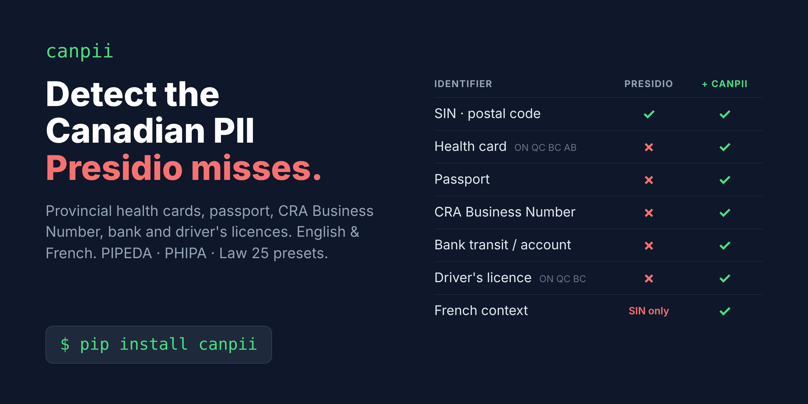

<p align="center">
  
</p>

<p align="center">
  <a href="https://pypi.org/project/canpii/"></a>
  <a href="https://github.com/ArthurJZL/canpii/actions/workflows/ci.yml"></a>
  
  
  <a href="https://github.com/ArthurJZL/canpii/issues?q=is%3Aissue+is%3Aopen+label%3A%22good+first+issue%22"></a>
</p>

<p align="center">
  <b>Canadian PII recognizers for <a href="https://github.com/data-privacy-stack/presidio">Microsoft Presidio</a></b><br>
  Provincial health cards · passport · CRA Business Number · bank accounts · driver's licences<br>
  English &amp; French · LiteLLM and MCP-gateway exports · PIPEDA / PHIPA / Québec Law 25 presets
</p>

---

## See it in 10 seconds

```diff
- Jane Tremblay, OHIP 1234-567-897 AB, passport GA123456.
+ <PERSON>, OHIP <CA_HEALTH_NUMBER>, passport <CA_PASSPORT>.

- Refund to transit 00011-003, account 1234567.
+ Refund to transit <CA_BANK_ACCOUNT>, account <CA_BANK_ACCOUNT>.

- Carte santé BOUF 9451 1419, entreprise 123456782 RT 0001.
+ Carte santé <CA_HEALTH_NUMBER>, entreprise <CA_BN>.

- Permis de conduire L1234-567890-12.
+ Permis de conduire <CA_DRIVER_LICENSE>.
```

Stock Presidio has no recognizer for any of these Canadian identifiers. *(All identifiers on this page are synthetic.)*

## Why

[Presidio](https://github.com/data-privacy-stack/presidio) is the most widely used open-source PII detector, but for Canada it ships only `CA_SIN` and `CA_POSTAL_CODE`. Health card numbers, passports, Business Numbers, bank details and driver's licences go straight through, while closed tools (Microsoft Purview's PIPEDA/PHIPA templates, AWS Bedrock Guardrails) do detect them.

If you put an LLM, a log pipeline or an analytics store in front of Canadian **healthcare, banking or government** data, that gap matters. canpii closes it today, in Presidio's own style, and [upstreams](#relationship-to-upstream-presidio) whatever Presidio accepts.

## Quickstart

```bash
pip install canpii
python -m spacy download en_core_web_sm
python -m spacy download fr_core_news_sm
```

```python
from presidio_anonymizer import AnonymizerEngine
from canpii import create_analyzer

analyzer = create_analyzer(languages=["en", "fr"])
text = "Patient Jane Tremblay, OHIP 1234-567-897 AB, passport GA123456. Refund to transit 00011-003, account 1234567."
results = analyzer.analyze(
    text,
    language="en",
    entities=["PERSON", "CA_HEALTH_NUMBER", "CA_PASSPORT", "CA_BANK_ACCOUNT"],
    score_threshold=0.4,
)
print(AnonymizerEngine().anonymize(text=text, analyzer_results=results).text)
# Patient <PERSON>, OHIP <CA_HEALTH_NUMBER>, passport <CA_PASSPORT>. Refund to transit <CA_BANK_ACCOUNT>, account <CA_BANK_ACCOUNT>.
```

**Already have an `AnalyzerEngine`?** One line adds everything:

```python
from presidio_analyzer import AnalyzerEngine
from presidio_anonymizer import AnonymizerEngine
from canpii import register_all

analyzer = AnalyzerEngine()  # your existing engine (Presidio's default uses en_core_web_lg)
register_all(analyzer.registry, languages=("en",))
text = "Patient OHIP 1234-567-897 AB, BC PHN 9000 000 018."
results = analyzer.analyze(text, language="en", score_threshold=0.4)
print(AnonymizerEngine().anonymize(text=text, analyzer_results=results).text)
# Patient OHIP <CA_HEALTH_NUMBER>, BC PHN <CA_HEALTH_NUMBER>.
```

`register_all()` also enables Presidio's own `CaSinRecognizer` and `CaPostalCodeRecognizer`. Use a **score threshold around 0.4**: weak, context-dependent patterns only cross it when a context word ("OHIP", "carte santé", "permis de conduire", …) is nearby.

**Using a policy?** Pick a preset instead of listing entities:

```python
from canpii import get_preset

entities = get_preset("phipa").entity_list()   # or "pipeda", "quebec_law25"
```

<details>
<summary>No-code / YAML setup</summary>


```python
import canpii  # registers the classes so `type: predefined` entries resolve
from presidio_analyzer.recognizer_registry import RecognizerRegistryProvider

registry = RecognizerRegistryProvider(
    conf_file=canpii.recognizer_registry_yaml()
).create_recognizer_registry()
```

</details>

## Coverage

| | Health card | Driver's licence |
|---|:---:|:---:|
| **Ontario** | ✅ OHIP | ✅ |
| **Québec** | ✅ RAMQ | ✅ |
| **British Columbia** | ✅ PHN (MOD-11 checksum) | ✅ |
| **Alberta** | ✅ AHCIP | [🙋 #4](https://github.com/ArthurJZL/canpii/issues/4) |
| **Manitoba** | [🙋 #1](https://github.com/ArthurJZL/canpii/issues/1) | [🙋 #5](https://github.com/ArthurJZL/canpii/issues/5) |
| **Saskatchewan** | [🙋 #2](https://github.com/ArthurJZL/canpii/issues/2) | 🙋 |
| **Nova Scotia** | [🙋 #3](https://github.com/ArthurJZL/canpii/issues/3) | 🙋 |
| **New Brunswick · PEI · Newfoundland and Labrador · territories** | 🙋 | 🙋 |

**Federal:** ✅ SIN · ✅ postal code · ✅ passport · ✅ CRA Business Number (`CA_BN`) · ✅ bank transit / routing / account · [🙋 IRCC UCI #6](https://github.com/ArthurJZL/canpii/issues/6)

✅ supported · 🙋 **open for contributors**: pick one ([how](CONTRIBUTING.md)).

<details>
<summary>Formats and validation rules for every entity</summary>

| Entity | Province | Format | Validation | Format source | Languages |
|---|---|---|---|---|---|
| `CA_HEALTH_NUMBER` | ON (OHIP) | 10 digits + optional 1–2 letter version code | structure; Luhn as bonus only (community-sourced) | official | en, fr |
| `CA_HEALTH_NUMBER` | QC (RAMQ / NAM) | 4 letters + 8 digits with embedded birth date | structure + birth-date check | official | en, fr |
| `CA_HEALTH_NUMBER` | BC (PHN) | 10 digits starting with 9 | MOD-11 checksum | official | en, fr |
| `CA_HEALTH_NUMBER` | AB (AHCIP) | 9 digits | context-only | official | en, fr |
| `CA_PASSPORT` | federal | 2 letters + 6 digits | context-only | secondary | en, fr |
| `CA_BN` | federal | 9 digits, or BN + RT/RP/RC/… + 4 digits | program id check; Luhn as bonus only (community-sourced) | official | en, fr |
| `CA_BANK_ACCOUNT` | federal | `TTTTT-III` transit, `0IIITTTTT` routing, 7–12 digit account | context-only | official / secondary | en, fr |
| `CA_DRIVER_LICENSE` | ON | 1 letter + 14 digits (`A1234-56789-01234`) | structure; birth date as bonus only | secondary | en, fr |
| `CA_DRIVER_LICENSE` | QC | 1 letter + 12 digits | context-only | secondary | en, fr |
| `CA_DRIVER_LICENSE` | BC | 7 digits | context-only (very weak) | secondary | en, fr |
| `CA_SIN`, `CA_POSTAL_CODE` | federal | — | upstream Presidio recognizers, enabled by `register_all()` | — | en, fr |

Every rule, with its source URL and confidence level, is in
[`docs/entities.md`](docs/entities.md). Rules that are only **secondary** or
**community-sourced** never reject a match on their own; they raise the score when
they pass (pass `strict=True` to also reject on failure). Rules from **official**
sources reject matches that fail them.

</details>

## Use it in your LLM gateway

canpii exports its recognizers for tools that speak plain regex:

```bash
canpii export --format litellm --preset pipeda -l en,fr -o canpii_ad_hoc.json   # LiteLLM Presidio guardrail
canpii export --format contextforge --preset phipa                              # IBM ContextForge PII filter
canpii export --format generic                                                  # any MCP / API gateway
```

<details>
<summary>All export formats and what you lose without Python</summary>

```bash
# LiteLLM presidio_ad_hoc_recognizers JSON (one copy per language)
canpii export --format litellm --preset pipeda -l en,fr -o canpii_ad_hoc.json
# LiteLLM config.yaml guardrail snippet (pii_entities_config for the preset, MASK)
canpii export --format litellm-config --preset pipeda
# IBM ContextForge PIIFilterPlugin custom_patterns (distinctive formats only)
canpii export --format contextforge --preset phipa
# Gateway-neutral regex + entity + score + context JSON
canpii export --format generic
# Presidio RecognizerRegistryProvider YAML (keeps full validation)
canpii export --format presidio-yaml --preset quebec_law25
```

**Regex-only exports lose validation.** LiteLLM's ad-hoc recognizers and gateway
custom patterns are plain regular expressions: BC's MOD-11 checksum, the RAMQ
birth-date check, the Luhn bonuses and the negative-context filter do not travel with
them. Expect more false positives than with the Python package. The ContextForge
export keeps only patterns with a base score ≥ 0.3, because gateways without context
support would otherwise redact every 7- to 12-digit number. All exported regexes avoid
look-arounds and back-references so they also compile in Rust's `regex` crate.

For LiteLLM, the Presidio analyzer server must have a French spaCy model loaded to use
`presidio_language: fr`. If you can run your own analyzer image, `pip install
canpii` into it and load the `presidio-yaml` export instead: you keep every
check.

</details>

## How accurate is it?

On a bilingual synthetic benchmark (1,740 sentences, threshold 0.4), with context words present:

| Entity | Precision | Recall |
|---|---:|---:|
| CA_HEALTH_NUMBER | 0.87 | 1.00 |
| CA_PASSPORT | 1.00 | 1.00 |
| CA_BN | 1.00 | 1.00 |
| CA_BANK_ACCOUNT | 0.71 | 1.00 |
| CA_DRIVER_LICENSE | 0.91 | 1.00 |

This is a **regression benchmark on sentences we wrote, not a real-world accuracy estimate**. Along the way it surfaced a bug in upstream Presidio: `CA_SIN`'s context word "sin" matches inside "bu**sin**ess" ([presidio#2459](https://github.com/data-privacy-stack/presidio/issues/2459)). `create_analyzer()` avoids it by using whole-word context matching.

<details>
<summary>Full benchmark tables and methodology</summary>

`benchmarks/run_benchmark.py` generates a labeled bilingual synthetic corpus (1,740
sentences: 740 positives with and without context words, 1,000 negatives including
phone numbers, dates, order IDs, amounts, near-miss identifiers and "hard negatives"
that put a context word next to an unrelated number) and reports precision/recall at
threshold 0.4.

Positives **with context words** (seed 2026, `presidio-analyzer` 2.2.366, spaCy `*_sm`):

| Entity | Gold | P (substring) | R (substring) | P (whole-word) | R (whole-word) |
|---|---:|---:|---:|---:|---:|
| CA_HEALTH_NUMBER | 160 | 0.870 | 1.000 | 0.870 | 1.000 |
| CA_PASSPORT | 40 | 1.000 | 1.000 | 1.000 | 1.000 |
| CA_BN | 40 | 1.000 | 1.000 | 1.000 | 1.000 |
| CA_BANK_ACCOUNT | 100 | 0.714 | 1.000 | 0.714 | 1.000 |
| CA_DRIVER_LICENSE | 120 | 0.909 | 1.000 | 0.909 | 1.000 |
| CA_SIN (upstream) | 20 | 0.526 | 1.000 | 1.000 | 1.000 |

All positives, including sentences **without** context words:

| Entity | Gold | P (substring) | R (substring) | P (whole-word) | R (whole-word) |
|---|---:|---:|---:|---:|---:|
| CA_HEALTH_NUMBER | 240 | 0.896 | 0.863 | 0.896 | 0.863 |
| CA_PASSPORT | 60 | 1.000 | 0.667 | 1.000 | 0.667 |
| CA_BN | 60 | 1.000 | 0.933 | 1.000 | 0.933 |
| CA_BANK_ACCOUNT | 160 | 0.714 | 0.625 | 0.714 | 0.625 |
| CA_DRIVER_LICENSE | 180 | 0.921 | 0.778 | 0.921 | 0.778 |
| CA_SIN (upstream) | 40 | 0.679 | 0.950 | 1.000 | 0.950 |

How to read this:

* **This is a regression benchmark on template sentences we wrote, not a real-world
  accuracy estimate.** Scores and negative-context words were tuned on part of the
  negatives; the remaining false positives come from an "untuned" set ("Patient chart
  1234567890", "Bank statement page …", "Driver ID …") where a context word sits next
  to an unrelated number — something no pattern recognizer can resolve.
* Context-only identifiers (Alberta PHN, BC licence, bank account, passport) are
  intentionally missed without context words; that is what lowers recall in the second
  table.
* "substring" vs "whole-word" is Presidio's context matching mode.
  `create_analyzer()` defaults to whole-word: in substring mode, upstream `CA_SIN`'s
  context word "sin" matches inside "bu**sin**ess", so every Business Number next to the
  word "business" is also reported as a SIN.

Reproduce with `uv run python benchmarks/run_benchmark.py --show-errors`.

</details>

## Contributing

**Know your province's health card or licence format? That's a small PR.** Each one is a self-contained recognizer + validator + tests, with a step-by-step recipe in [CONTRIBUTING.md](CONTRIBUTING.md) and ready-made [good first issues](https://github.com/ArthurJZL/canpii/issues?q=is%3Aissue+is%3Aopen+label%3A%22good+first+issue%22). Francophones: reviewing the Québec French wording ([#7](https://github.com/ArthurJZL/canpii/issues/7)) is just as valuable as code.

Every format rule must cite a source, and **never use real identifiers**, only synthetic ones. Commits are signed off (DCO).

## Relationship to upstream Presidio

* This is an independent community package, **not affiliated with Microsoft or the
  Presidio maintainers**. It builds on Presidio's public APIs (`PatternRecognizer`,
  `RecognizerRegistry`, `RecognizerRegistryProvider`) and follows its contribution
  conventions: one recognizer class per file, `COUNTRY_CODE = "ca"`, per-language
  instances, `invalidate_result` for checks, source URLs in docstrings.
* Credit to the Presidio maintainers and to the upstream Canadian contributors:
  `CA_SIN`, and `CA_POSTAL_CODE` (presidio#2204, by GitHub user watsos). We use those recognizers as
  they are rather than reimplementing them.
* **Business Number:** upstream issue presidio#2206 proposes a `CA_BN` recognizer and
  PR presidio#2207 by GitHub user Joey239716 implements it (open since 2026-07-29). Our
  `CA_BN` recognizer is an independent implementation written from the CRA
  documentation and deliberately uses the same entity name, so switching is seamless.
  **Once #2207 (or an equivalent) is merged, we will defer to upstream**: deprecate ours
  for one minor release, then delegate.
* Upstreaming plan: recognizers whose formats are backed by official sources (BC PHN,
  RAMQ first) will be proposed to Presidio as individual PRs, in Presidio's code style,
  once they have had real-world use here. See [`docs/roadmap.md`](docs/roadmap.md).

## Disclaimer

* **Not legal advice.** Presets and documentation describe engineering starting points.
  Compliance with PIPEDA, PHIPA, Law 25 or any other law is your responsibility.
* **Detection is probabilistic.** Pattern recognizers miss identifiers and flag
  unrelated numbers. Do not rely on this package alone to protect sensitive data.
* **Synthetic data only.** All identifiers in this repository, its tests and its
  documentation are generated or obviously fake. Randomly generated values can still
  coincide with issued identifiers; never use them as real identifiers. **Never commit,
  paste or upload real identifiers** — not in issues, PRs, fixtures, screenshots or
  logs. See [`SECURITY.md`](SECURITY.md).
* Government programs and agencies are named only to describe the identifiers they
  issue; no endorsement is implied.

## License

[Apache-2.0](LICENSE). Presidio is MIT-licensed; see [`NOTICE`](NOTICE).
