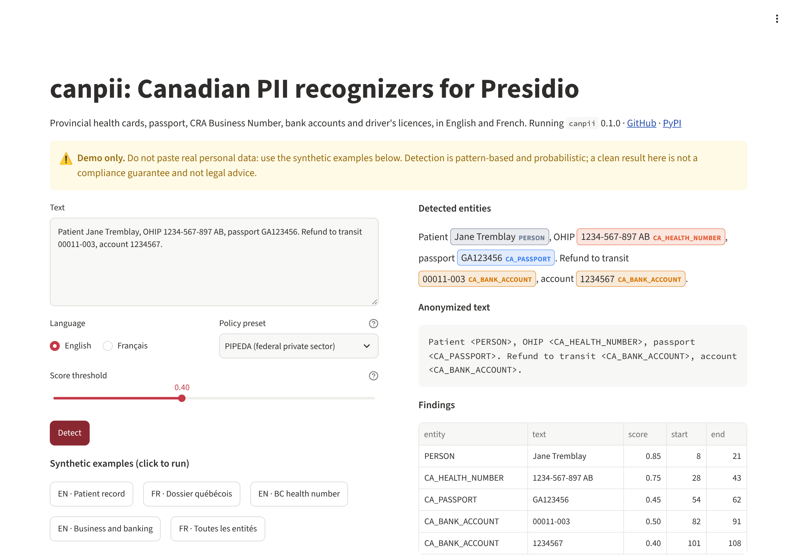

# canpii demo

A small [Streamlit](https://streamlit.io/) app for
[canpii](https://github.com/ArthurJZL/canpii), the Canadian PII recognizers for
Microsoft Presidio. Paste text, pick a language (English or French), a policy preset
(all entities, PIPEDA, PHIPA or Québec Law 25) and a score threshold, then press
**Detect**. The app shows the detected entities highlighted in the text, the anonymized
text and a table of findings.

**Demo only.** Do not paste real personal data. Every example in the app uses synthetic
identifiers. Detection is pattern-based and probabilistic: a clean result is not a
compliance guarantee and not legal advice.



## Run it locally

Use Python 3.12 (the version the hosted app runs on; Streamlit needs 3.11 or newer).

```bash
pip install -r demo/requirements.txt
streamlit run demo/app.py
```

Then open <http://localhost:8501>.

## Deploy on Streamlit Community Cloud

[Streamlit Community Cloud](https://streamlit.io/cloud) is free and deploys straight
from this GitHub repository; nothing is copied anywhere else.

1. Sign in with GitHub at <https://share.streamlit.io> and allow access to the
   `ArthurJZL/canpii` repository.
2. In your workspace, click **Create app** in the upper-right corner, then
   **Yup, I have an app**.
3. Fill in the form:

   | Field | Value |
   | --- | --- |
   | Repository | `ArthurJZL/canpii` |
   | Branch | `main` |
   | Main file path | `demo/app.py` |
   | App URL (optional) | `canpii` (gives `https://canpii.streamlit.app`) |

4. Click **Advanced settings**, choose **3.12** in the **Python version** dropdown,
   leave **Secrets** empty (the app needs none) and click **Save**.
5. Click **Deploy**. The first build installs the dependencies and takes a few minutes;
   the log is shown on the right of the page.
6. Open the app, click each example once to check the output, then un-comment the
   "Try it in your browser" line in the main `README.md` (and fix the URL there if the
   `canpii` subdomain was already taken).

Community Cloud installs `demo/requirements.txt` because it sits in the same directory
as the entrypoint file; that takes precedence over the `uv.lock` and `pyproject.toml`
in the repository root, which it would otherwise use. Every push to `main` redeploys
the app. When a new canpii version is released, bump `canpii==` in `requirements.txt`.

## Notes

* "All entities" runs every Presidio recognizer plus canpii, including spaCy NER labels
  such as `DATE_TIME` and `ORGANIZATION`. Those are noisy on bare numbers, which is why
  the default is the PIPEDA preset.
* Where two findings overlap, the app keeps the one with the higher score (then the
  longer one), the same preference Presidio's anonymizer applies.
* The app uses the small spaCy models (`en_core_web_sm`, `fr_core_news_sm`) so that it
  fits in Community Cloud's memory. With both languages loaded the Streamlit process
  measured about 450 MB resident (Python 3.12, Linux).
* The highlighted text is built as HTML by `highlight_html()` in `app.py`; the input
  text and the entity labels are escaped with `html.escape` before they are inserted.
